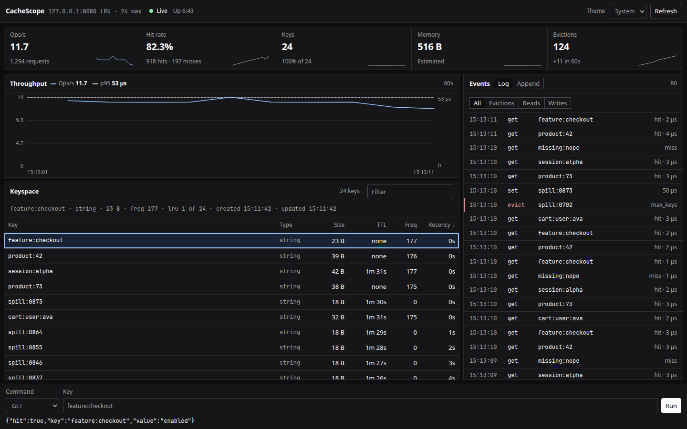
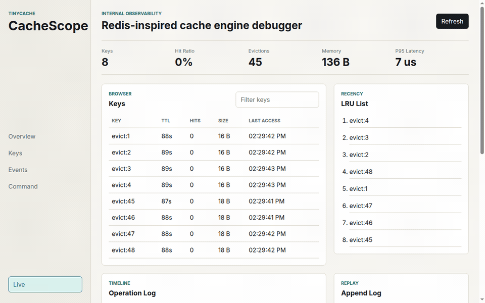

# TinyCache

[](https://github.com/nkmohit/tinycache/actions/workflows/ci.yml)

TinyCache is a Redis-inspired in-memory cache engine with HTTP commands and a debugging board. CacheScope shows TTL expiration, eviction, memory and key accounting, command rate and latency, and the event log.


## Features

- HTTP cache commands: `SET`, `GET`, `DEL`, `EXPIRE`, `TTL`.
- TTL cleanup with lazy expiration on read and a Redis-style background sweeper.
- Exact LRU and LFU, plus approximate `allkeys-lru`, `allkeys-lfu`, `allkeys-random`, and `volatile-ttl`. `noeviction` returns an OOM error.
- A key-count limit and a `maxmemory` byte limit. Each is split across the shards.
- Metrics with hit ratio, memory estimate, evictions, and latency percentiles.
- Debug endpoints for keys, LRU order, events, replay records, and one-call UI hydration.
- Checksummed snapshots and an append-only log with `always`, `everysec`, or `no` fsync, rewrite, and crash recovery.
- CacheScope static dashboard served by the Go server.
- Demo seeder and benchmark CLI.

## Run

```sh
go run ./cmd/tinycache --addr :8080
```

Optional flags:

```sh
go run ./cmd/tinycache \
  --addr :8080 \
  --max-keys 1000 \
  --maxmemory 0 \
  --maxmemory-samples 5 \
  --cleanup-interval 1s \
  --event-log-size 1000 \
  --eviction-policy lru \
  --snapshot-path "${TMPDIR:-/tmp}/tinycache.snapshot.json" \
  --aof-path "${TMPDIR:-/tmp}/tinycache.aof" \
  --appendfsync everysec \
  --auto-aof-rewrite-percentage 100 \
  --auto-aof-rewrite-min-size 67108864 \
  --ui-dir web/cachescope
```

## Commands

```sh
curl -X POST http://localhost:8080/command/set \
  -H 'Content-Type: application/json' \
  -d '{"key":"name","value":"tiny","ttlSeconds":60}'

curl 'http://localhost:8080/command/get?key=name'
curl 'http://localhost:8080/command/ttl?key=name'

curl -X POST http://localhost:8080/command/expire \
  -H 'Content-Type: application/json' \
  -d '{"key":"name","ttlSeconds":120}'

curl -X DELETE 'http://localhost:8080/command/del?key=name'
```

## Debug Endpoints

- `GET /metrics` returns aggregate counters, hit ratio, key count, memory estimate, latency summaries, evictions, and uptime.
- `GET /debug/info` returns the eviction policy and max key count.
- `GET /debug/keys` returns key metadata only. Supports `filter`, `sort`, `desc`, and `limit`.
- `GET /debug/summary` returns metrics, keys, LRU order, and recent events in one response.
- `GET /debug/lru` returns keys from most-recently-used to least-recently-used.
- `GET /debug/events` returns the bounded recent operation and eviction log.
- `GET /debug/events/stream` streams live snapshots for CacheScope over server-sent events.
- `GET /debug/replay` returns append-only log records when `--aof-path` is configured.
- `POST /admin/snapshot` writes a JSON snapshot when `--snapshot-path` is configured.
- `GET /healthz` returns server health.

## CacheScope

Run TinyCache with the static UI enabled:

```sh
make run
```

Then open `http://localhost:8080`. The board follows the system light or dark theme.





The clip is CacheScope while `SET` keeps writing into an 8-key cache. The eviction counter climbs, the keyspace turns over, and the event log records each `evict`. Start the server with `--max-keys 8`, then record it with headless Chrome and ffmpeg:

```sh
CACHESCOPE_DRIVE=1 CACHESCOPE_FRAMES_COUNT=12 CACHESCOPE_FRAME_MS=1000 \
  CACHESCOPE_GIF=docs/assets/cachescope-evictions.gif CACHESCOPE_FPS=2 \
  node scripts/record-cachescope-gif.js
```

Useful Make targets:

```sh
make
make build
make fmt
make test
make race
make bench
make bench-cli
make run
make demo
make smoke
```

Sample HTTP requests are available in `examples/tinycache.http`.

For a screenshot-ready demo:

```sh
make run MAX_KEYS=10
make demo
make screenshot
```

Headless Chrome writes the screenshot to `docs/assets/cachescope.png`. `CACHESCOPE_COLOR_SCHEME=dark` records the dark theme.

## Benchmarks

Numbers below are the tables in [docs/benchmarks.md](docs/benchmarks.md), measured on the 4-core cloud VM (Intel Xeon, Linux 6.12, Go 1.22).

`SET` used to walk every key looking for expirations. Sampling the TTL set dropped that cost:

| | before | after |
| --- | ---: | ---: |
| `BenchmarkSet` | 129,590 ns/op (7,717 ops/s) | 906 ns/op (1,103,387 ops/s) |
| `BenchmarkGetHit` | 301 ns/op | 298 ns/op |
| bench CLI, LRU, 100k ops, 10k keys, 30% writes | 32,509 ops/s | 1,970,416 ops/s |
| bench CLI, LFU, same workload | 13,434 ops/s | 27,895 ops/s |

LFU was still scanning every resident key to pick a victim. Frequency buckets and 16 shards were remeasured on this VM just before and after that change (the baseline is a fresh run, so it sits a little off the 906 ns/op row above):

| | before | after |
| --- | ---: | ---: |
| bench CLI, LFU, 100k ops, 10k keys, 30% writes | 27,944 ops/s | 1,599,824 ops/s |
| bench CLI, LRU, same workload | 1,987,993 ops/s | 1,761,864 ops/s |
| `BenchmarkEvictLFU` | 2,421 ns/op | 1,018 ns/op |
| `BenchmarkGetHitParallel` | 1,007 ns/op | 768 ns/op |
| `BenchmarkMixedParallel` | 676 ns/op | 446 ns/op |
| `BenchmarkSet` (single goroutine) | 852 ns/op | 1,040 ns/op |
| `BenchmarkGetHit` (one hot key) | 295 ns/op | 289 ns/op |

That single-threaded slowdown was the admission lock and the 16-shard lock on eviction. Giving each shard its own budget removes both. Median of three runs on this VM, immediately before the change and after it:

| | before | after |
| --- | ---: | ---: |
| `BenchmarkSet` | 1,068 ns/op (936,330 ops/s) | 898 ns/op (1,113,586 ops/s) |
| `BenchmarkEvictLRU` | 1,008 ns/op | 746 ns/op |
| `BenchmarkEvictLFU` | 1,041 ns/op | 779 ns/op |
| `BenchmarkGetHit` | 297 ns/op | 306 ns/op |
| bench CLI, LRU, 100k ops, 10k keys, 30% writes | 1,651,650 ops/s | 1,788,250 ops/s |
| bench CLI, LFU, same workload | 1,451,155 ops/s | 1,587,813 ops/s |

## Design tradeoffs

### Locking on GET, and sharding

A GET updates recency (and, for LFU, the frequency bucket), so it takes the write lock of the shard that owns the key. There are 16 shards, and each key hashes to one of them. GETs of different keys take different locks. Operations on one key still run one at a time. A single hot key still takes one shard lock, which is why `BenchmarkGetHit` stayed near 290 ns/op while `BenchmarkGetHitParallel` went from 1,007 ns/op to 768 ns/op.

### Per-shard capacity

`maxKeys` and `maxmemory` are divided by 16. The first remainder shards get one extra key or one extra byte, and the shares sum to the configured total. A write locks only the shard that owns the key. If that shard is over its own budget it evicts one of its own keys.

The tradeoff is skew. Keys that hash onto one shard evict there while other shards still have free slots, so the process can hold fewer keys than `maxKeys`. At 10,000 keys the share is 625 and a uniform hash stays close to that. Below 16 keys some shards get a share of zero and a new key on one of those shards returns an OOM error.

`maxmemory` counts key bytes plus value bytes plus 128 bytes of overhead per entry. It is an estimate, not a read of the heap. Zero means no byte limit. The key limit still applies.

### Exact and sampled eviction

`lru` and `lfu` are exact inside the shard: the LRU tail, or the tail of the lowest frequency bucket. `allkeys-lru` draws `maxmemory-samples` keys (default 5) and evicts the one with the oldest LRU clock, the Unix second of the last access. `allkeys-lfu` draws the same sample and evicts the lowest logarithmic counter. That counter starts at 5, increments with probability `1/(base*10+1)`, and drops by one per idle minute (Redis `lfu-log-factor` 10 and `lfu-decay-time` 1). `allkeys-random` deletes one random key. `volatile-ttl` samples only keys that expire and deletes the soonest. It returns an OOM error when the shard has no expiring key. `noeviction` returns that error when the shard is at either limit.

A sample can miss the coldest key and keep it. Exact mode evicts that key. Exact LFU still keeps the per-frequency lists. Sampled policies skip that second list element.

### LFU buckets

Each shard keeps a doubly linked list per access count and the smallest count that still has a key. Eviction removes the tail of that list, which is O(1). Inside one count, the tail is the key touched least recently, the same tie-break as the old full scan (lower access count, then older last access).

The price is a second list element on every key, and finding the next minimum when the lowest bucket becomes empty (a walk of the live frequencies, not of the keys). GET promotion is an unlink and a link. The LRU list is still updated so `/debug/lru` can show recency while the policy is LFU. On a 10,000-key working set the bench CLI went from 27,944 ops/s to 1,599,824 ops/s.

### Persistence

Startup loads the snapshot, then replays the append-only file. Expiry is an absolute timestamp, so a key that expired while the process was down stays expired. Layouts are in [docs/persistence.md](docs/persistence.md).

#### Fsync

`--appendfsync` follows Redis `appendfsync`. A failed append is logged and returned to the caller, and the in-memory change is not published.

| Policy | What returns | What a crash can lose |
| --- | --- | --- |
| `always` | after `fsync` of that command | a command whose `fsync` did not finish |
| `everysec` (default) | after the append | about one second of commands; `Close` syncs once more |
| `no` | after the append | whatever the kernel has not flushed yet |

#### AOF rewrite

`RewriteAOF` compacts the log to the keys that are live at one moment. Each shard lock is taken in index order, then the AOF lock, and only while that set of keys is copied. The temp file is written after those locks are released. Commands that arrive after the copy go to the live log and into a buffer. A key or memory eviction in that window is a `del` in the buffer, so the evicted key does not return when the file is replayed. Before the new file becomes current, that buffer is appended, the temp file is fsynced, it is renamed over the AOF, and the directory is fsynced. Writers stall for that final fsync and rename, and they keep running while the key set is serialized.

A crash before the rename leaves the previous AOF in place. The compacted file is fsynced before the rename for every `--appendfsync` policy, so the file that is swapped in is a complete image. Commands appended after the swap follow the configured policy again.

The rewritten file starts with a `base` command. Replay clears the in-memory image, including keys that came from the snapshot, then applies the compacted key set. A key deleted before the rewrite stays deleted when an older snapshot still contains it.

Automatic rewrite follows Redis `auto-aof-rewrite-percentage` and `auto-aof-rewrite-min-size`. The server defaults are 100 and 64MiB. Percentage 0 turns it off. The Go library leaves it off until `AOFRewritePercentage` is set. A rewrite starts when the file is at least the minimum size and has grown by that percent since the last rewrite, or since startup when none has run.

#### Snapshots

`SaveSnapshot` writes a temp file in the destination directory, fsyncs it, renames it into place, and fsyncs the directory. A crash during the write keeps the previous snapshot. Version 2 carries CRC-32/IEEE and CRC-64/ECMA-182 of the payload. Load checks both and returns `corrupt snapshot` for a bad checksum, a short file, or JSON that does not parse. Version 1 snapshots, a single JSON document with no checksum, still load.

#### Crash recovery

A final AOF record with no trailing newline that is not valid JSON is cut off and logged, the same idea as Redis `aof-load-truncated yes`. A bad record that ends in a newline aborts startup with `corrupt append-only file`, including when that record is the last line. The process does not serve a half-applied log.

## Test

```sh
go test ./...
go test -race ./...
go test -bench=. ./internal/cache
make lint
make fuzz
```
